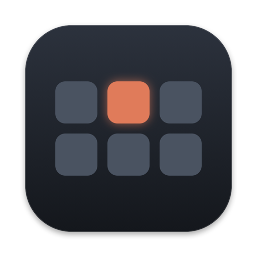
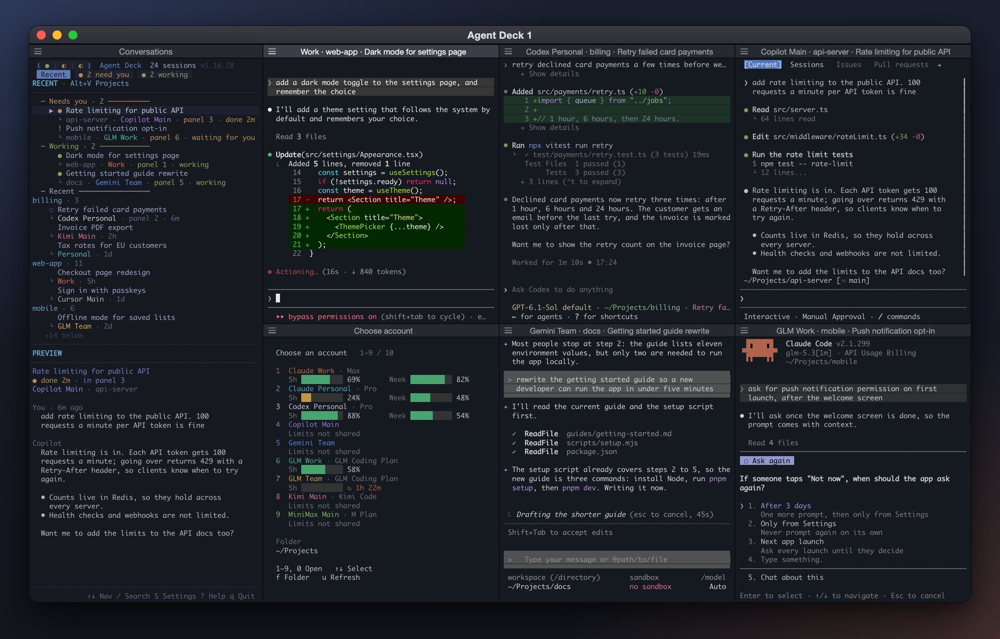
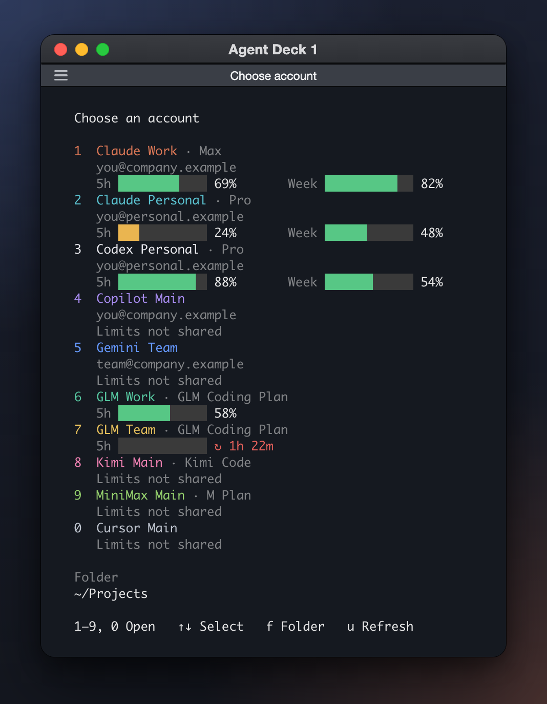

<p align="center">
  
</p>

<h1 align="center">Agent Deck</h1>

<p align="center">
  Six AI coding chats side by side in one Mac app, on your Claude, ChatGPT, Antigravity, Copilot, Gemini, GLM, Kimi and other subscriptions, with every conversation one click away.
</p>

<p align="center">
  
</p>

## Install

Paste this into Terminal:

```sh
curl -fsSL https://raw.githubusercontent.com/tadyuh76/agent-deck/main/install.sh | zsh
```

It asks a few things:

- which AI subscriptions you use, and the accounts for each
- the folder where new chats start
- whether chats may run commands without asking each time
- the model and effort Claude and Codex chats start with (Enter keeps the usual one)

Then it signs each account in, through the browser or with a key from the subscription's site, and builds everything on your Mac. The first install takes about 5–10 minutes.

It installs anything missing along the way: Homebrew, Node, tmux, Go, git, iTerm2, and the tool each of your subscriptions runs in (Claude Code, Codex, Antigravity CLI, Copilot CLI, Gemini CLI and so on). Node and Go come from their official downloads and tmux is built on your Mac in about three minutes, so nothing waits on Homebrew compiling from source, even on a macOS version it no longer packages for.

**Mac only** (macOS 14 or later). There is no Windows version: the app is built from iTerm2, which runs only on the Mac.

## Subscriptions

| Subscription | Plans | Signs in with | Moves to another account at its limit | Limits shown |
| --- | --- | --- | :---: | --- |
| **Claude** · Anthropic | Pro, Max, Team, Enterprise | browser | ✓ | 5-hour, weekly |
| **Codex** · OpenAI | ChatGPT Plus, Pro, Business, Enterprise | browser | ✓ | 5-hour, weekly |
| **Antigravity** · Google | Google AI Pro, Ultra, or free | browser | ✓ | 5-hour, weekly |
| **Copilot** · GitHub | Pro, Pro+, Max, Business, Enterprise | device code | ✓ | |
| **Gemini** · Google | Gemini Code Assist Standard, Enterprise | browser | ✓ | |
| **GLM** · Z.ai | GLM Coding Plan | key | ✓ | 5-hour |
| **Kimi** · Moonshot AI | Kimi Code membership | key | ✓ | |
| **MiniMax** | M Plan | key | ✓ | |
| **Qwen** · Alibaba Cloud | Model Studio Coding Plan | key | ✓ | |
| **Synthetic** | subscription packs | key | ✓ | |
| **Cursor** | Plus, Premium, Super, Ultra | key | | |
| **OpenCode** | Go, Zen, or any provider it signs in to | browser or key | | |
| **Droid** · Factory | Pro, Plus, Max | key | | |
| **Kiro** · Amazon | Pro, Pro+, Pro Max, Power | key | | |
| **Vibe** · Mistral | Le Chat Pro, Team | key | | |
| **Amp** | Individual, or credits | key | | |

- **GLM, Kimi, MiniMax, Qwen and Synthetic run inside Claude Code**, pointed at the plan's own server. Their chats work like Claude chats: named on their own, listed, and moved between accounts.
- **A chat only moves to another account of the same subscription**, and carries on there with its full history.
- **Antigravity keeps a pool of Google accounts** through the [Antigravity account switcher](https://github.com/muriel-gasparini/antigravity-account-switcher). Sign in as many as you like; when one runs out, the request in flight moves to the next, without restarting the chat.
- **Keys stay on your Mac**, each in its account's own folder.
- **Use accounts you are entitled to.** Some plans forbid sharing an account or scripted use.

## What you get

- **One app in your Dock.** Click it to bring your decks back. Right-click it, or press `⌘N`, for a new deck.
- **Six chats at once.** Each deck window has six panels, each a live chat on any of your accounts, titled *account · project · chat name*.
- **Every conversation in one list.** The left side groups chats into *Needs you*, *Working* and *Recent*, with recent ones grouped by project. Double-click one to open it in a free panel, or to jump to the panel that already has it.
- **Several accounts on several subscriptions.** Each account's usage shows as bars where its subscription reports it.
- **Auto-continue.** When a chat reaches an account's limit, it carries on by itself in the account of the same subscription with the most room left. Switch it off to choose the account yourself: press `a` in an empty panel, `Ctrl+B` then `a` in a chat, or right-click the Dock icon.
- **Your model and effort.** New Claude and Codex chats start with the model and effort you chose. Any chat can still switch with `/model`.
- **Nothing stops when you close it.** Closing a deck window or quitting the app only closes the view; every chat keeps running, and each panel shows its chat again when the deck reopens.

<p align="center">
  
  <br>
  <sub>Every account, on every subscription, in one menu.</sub>
</p>

## Using it

- **Start a chat:** in an empty panel, press an account's number (`1`–`9`, `0`), or pick it with `↑` `↓` and press Enter. Press `f` first to start in another folder.
- **Open a chat:** double-click it in the list on the left, or select it and press Enter.
- **Panels are panes:** drag the dividers to resize, `⌘⇧↩` to zoom one, `⌘⌥` + arrows to move between them.
- **Copy text:** drag over it and let go; it is on the clipboard.
- **Shortcuts:** press `Ctrl+B`, then:

  | Key | Does |
  | --- | --- |
  | `r` / `d` | recent list / project tree |
  | `g` | jump to the panels |
  | `n` | account menu in this panel (`r` there returns to the chat) |
  | `s` | move this chat to another account |
  | `a` | auto-continue on or off |
  | `z` | zoom this panel |
  | `w` | another deck window |

## Accounts, folder, updates

```sh
# Add another account, on any subscription
curl -fsSL https://raw.githubusercontent.com/tadyuh76/agent-deck/main/install.sh | zsh -s -- --add-account

# Sign in the accounts that are not signed in yet
curl -fsSL https://raw.githubusercontent.com/tadyuh76/agent-deck/main/install.sh | zsh -s -- --sign-in

# Change the model and effort new Claude and Codex chats start with
curl -fsSL https://raw.githubusercontent.com/tadyuh76/agent-deck/main/install.sh | zsh -s -- --models

# Change the folder where new chats start
curl -fsSL https://raw.githubusercontent.com/tadyuh76/agent-deck/main/install.sh | zsh -s -- --folder ~/Code

# Update: run the install line again. The chat engine also updates itself each morning.
curl -fsSL https://raw.githubusercontent.com/tadyuh76/agent-deck/main/install.sh | zsh

# Uninstall (your accounts and conversations stay)
curl -fsSL https://raw.githubusercontent.com/tadyuh76/agent-deck/main/install.sh | zsh -s -- --uninstall
```

Your first Claude account uses Claude Code's usual folder (`~/.claude`). Every other account gets a folder of its own for its sign-in or key, so accounts never mix.

## How it is made

- **The app** is your own installed iTerm2, copied under the name Agent Deck with a small add-on that arranges the deck windows. It is built on your Mac during setup; nothing prebuilt is downloaded. Your own iTerm2, its windows and its settings are left alone.
- **The chats** run in [agent-deck](https://github.com/asheshgoplani/agent-deck) with this project's changes, built from source, each in its subscription's own tool. Each morning it picks up new agent-deck releases and applies the changes again.
- Problems are written to `~/Library/Logs/Agent Deck.log`.

## Credits

Built on [agent-deck](https://github.com/asheshgoplani/agent-deck) by Ashesh Goplani (MIT), [iTerm2](https://iterm2.com) by George Nachman (GPL-2.0) and, for Antigravity, the [Antigravity account switcher](https://github.com/muriel-gasparini/antigravity-account-switcher) by Muriel Gasparini (MIT). Agent Deck is an independent project, not made by or affiliated with Anthropic, OpenAI, GitHub, Google, Z.ai, Moonshot AI, MiniMax, Alibaba Cloud, iTerm2, agent-deck or any other company named here.

## License

[MIT](LICENSE)
